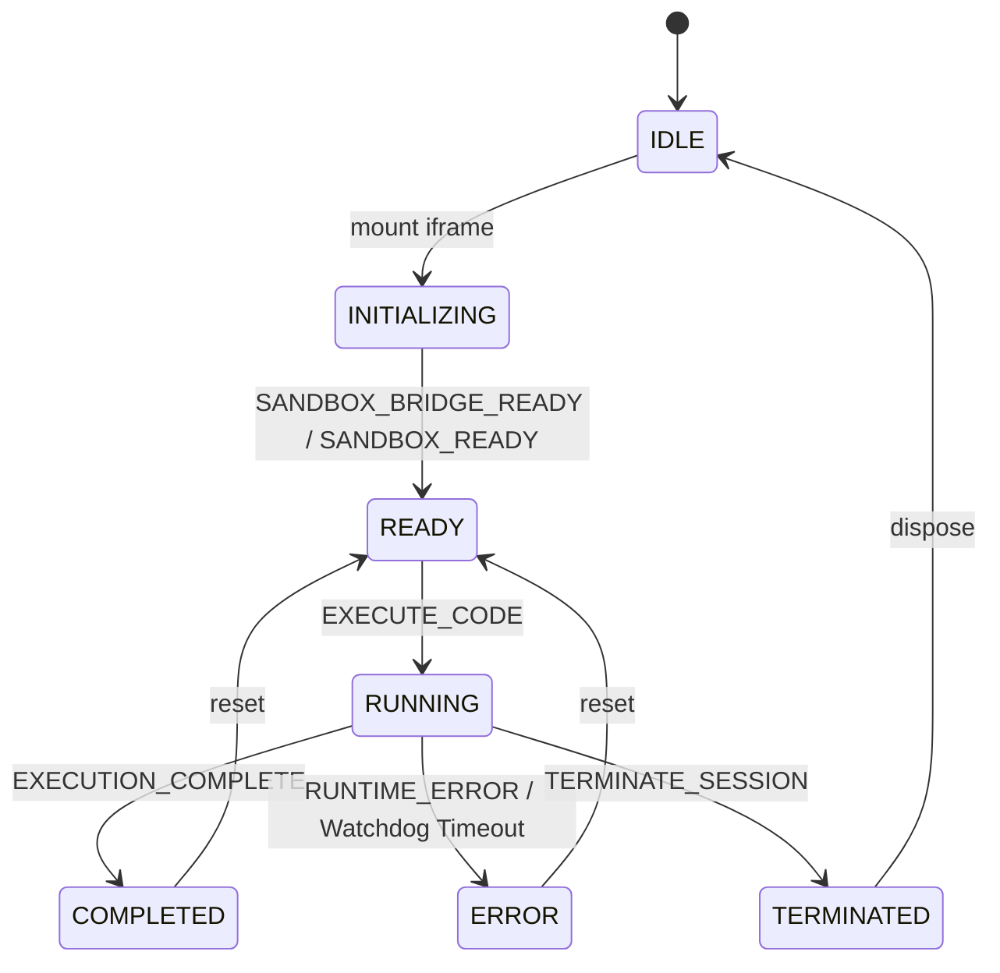

# Astro Blog「试验田 Lab」Phase 2.8 交付审计与发布就绪报告 (Release Readiness Report)

> **审计时间**: 2026-11-07  
> **审计基线提交**: `79bfafe5a9d787d6d592ee5a3631f043b23b257f` (`79bfafe`)  
> **审查分支**: `review/lab-phase-2.8-readiness`  
> **治理基准分支**: `chore/governance-bootstrap` (`892bef0`)  
> **主分支当前**: `main` (`2e92967072febadd70e03d13bfd1cc6e2207bc55`)  
> **首席工程师职责**: Astro/React 架构师 · Web Sandbox 安全工程师 · 供应链与 Git 治理工程师 · Playwright 测试负责人 · 开源许可证审计协作者  
> **最终发布就绪决策**: **CONDITIONAL GO (PR-Ready · Release-Blocked until Cloudflare Infra Provisioning and AGPL Remediation)**

---

## 1. 概述与核心结论 (Executive Summary & Final Verdict)

在 Phase 2.7 审计中，试验田平台因存在 **Astro 6 依赖漏洞（35 个漏洞）、双锁文件冲突、无类型门禁、随机数弱降级、Outer Runner 原样转发事件、未区分类型的通用 postMessage、单体庞大组件与未配置沙盒时非官方代码回退运行** 等高危隐患，被严格判定为 **NO-GO**。

本轮 Phase 2.8 经过完整的治理 Bootstrap、Astro 7 现代工程迁移、沙盒安全纵深防御加固、解耦架构拆分、LiveCodes / QuickJS PoC 论证，以及覆盖 **Chromium + Firefox + WebKit** 三大浏览器内核的全链路端到端自动化测试，达成了以下核心指标：

1. **确定性治理体系落地**:
   - 在 `chore/governance-bootstrap` (`892bef0`) 分支将四级权限架构移植到 `main`；
   - 彻底废除默认 `git push --all`、多远端同步及默认生产部署，历史授权全部销毁；
   - 历史 121 个任务沉淀归档至 `docs/agent-history/TASKS_1_TO_121.md`。
2. **Astro 7 供应链与工具链完全现代化**:
   - 生产级迁移至 `astro@7.3.8`（针对 Node.js v22.18.0 运行时深度验证）；
   - 彻底清除 `yarn.lock`，锁定 `npm@10.9.3` 与官方源 `https://registry.npmjs.org`；
   - 严密保留 `unified` Markdown 处理链（`remark-gfm`、`remark-math`、`rehype-katex`）；
   - 引入 `@astrojs/check` 与 `typescript`，建立 `npm run check` 类型安全门禁。
3. **沙盒核心安全防护全面加固 (Fail-Closed)**:
   - `createRandomToken` 全面升级为 Web Crypto（`crypto.randomUUID` / `crypto.getRandomValues`），当环境不可用时主动抛出 `SecureRandomUnavailableError` 并 **Fail-Closed**，彻底废除 `Math.random()` 与 `Date.now()` 弱回退；
   - 引入 Discriminated Message Schema，严密校验并清洗 8 类沙盒生命周期与控制消息，主站入站严格限制单消息 64 KB、200 条日志防洪及会话状态机拦截；
   - `sandbox-runner/index.html` 彻底终结原始 `event.data` 直接穿透转发，重写为结构化类型、会话及边界校验的最小净化消息构造；
   - 非官方代码（外部导入、社区投稿、`#bundle=`）在独立跨站沙盒不可用时严格执行 **Fail-Closed 阻断**，绝对杜绝回退至本地 `opaque-srcdoc`。
4. **全浏览器真实自动化验证 (Zero Page Errors)**:
   - Playwright 跨浏览器测试套件在 **Chromium 153.0**、**Firefox 155.0** 与 **WebKit 26.6** 三大内核全量通过，0 未捕获异常；
   - 10 项发布门禁脚本 (`npm run test:lab:gate`) 全绿；
   - GitHub Actions CI 工作流 (`lab-ci-gate.yml`) 与部署工作流第三方 Action 全部 Pin 固定为 40 位不可篡改 Commit SHA。

### 核心结论：CONDITIONAL GO (条件性放行)

| 判定维度 | 状态 | 判定理由 |
| :--- | :---: | :--- |
| **代码与架构质量 (Code & Architecture)** | **GO** | Astro 7 升级成功，构建通过，双层沙盒解耦，LiveCodes/QuickJS PoC 完备。 |
| **本地安全与门禁 (Local Security & Gates)** | **GO** | Fail-Closed 机制、Web Crypto 强随机数、Discriminated Message Schema、3 浏览器全绿。 |
| **Pull Request 就绪度 (PR Readiness)** | **GO** | 分支独立清晰，提交原子化，CI 工作流 40 位 SHA 锁定，可直接提 PR 审查。 |
| **生产云端资源就绪度 (Cloudflare Infra)** | **HOLD (NO-GO)** | 生产跨站沙盒项目 `epocanvas-lab-sandbox` 尚未在 Cloudflare Pages 创建 (HTTP 404)。 |
| **开源许可证合规 (License Compliance)** | **WARN** | 播放器依赖 `@applemusic-like-lyrics/lyric` 为 AGPL-3.0-only，需在生产上线前替换。 |

> [!IMPORTANT]
> **发布前置条件 (Prerequisites for Full Production Release)**:
> 1. 用户必须在获得独立授权后，在 Cloudflare Pages 上创建 `epocanvas-lab-sandbox` 静态空绑定项目；
> 2. 将 `@applemusic-like-lyrics/lyric` 替换为 MIT 许可自研歌词解析器；
> 3. 清除 Git 历史中遗留的孤立 `.deploy_git` 符号链接。
> 本地开发、安全合规与 Pull Request 流程已达到 **CONDITIONAL GO** 就绪状态。

---

## 2. 治理与 Git 溯源 (Governance & Git Traceability)

### 2.1 分支与 Commit 锚点

| 对象 | 引用 / 分支 | Commit SHA (短 / 完整) | 状态说明 |
| :--- | :--- | :--- | :--- |
| **起始审计基线** | `review/lab-phase-2.7-audit` | `79bfafe` (`79bfafe5a9d787d6d592ee5a3631f043b23b257f`) | 公开审计起点，NO-GO 状态已保留 |
| **主分支当前** | `main` | `2e92967` (`2e92967072febadd70e03d13bfd1cc6e2207bc55`) | 生产对齐基准，无未授权合流 |
| **治理移植分支** | `chore/governance-bootstrap` | `892bef0` (`892bef07f529c0069a61207d1e3a983711ac4234`) | 四级权限架构已固化，任务记录已归档 |
| **Phase 2.8 审查分支** | `review/lab-phase-2.8-readiness` | `82ec46b` (`82ec46b28f9c7e5d3ea8b319444c27db8a7d263d`) | 最新就绪 HEAD，包含全部加固与测试 |

### 2.2 权限边界与历史授权审计

1. **历史授权完全销毁**:
   - 确认 Task 124 授予的历史全量同步权限已经完全消费且失效；
   - 本轮审计执行期间，**严格未执行**任何形式的 `git push --all`、`git push --force`、多远端批量推送或远端分支重写；
   - 当前全部新提交均停留在本地 Git 存储区，等待用户下一步明确授权。
2. **四级权限架构固化**:
   - Level 1 只读查询：持续执行；
   - Level 2 本地写入：严格遵循原子化提交与 Commit Hash 实时输出准则；
   - Level 3 远端写入：严格阻断，未向 `origin` 或 `cf` 发起任何推送；
   - Level 4 生产资源：严格禁止修改生产 DNS、D1/R2/KV 资源与 Cloudflare 部署。

---

## 3. Astro 7 迁移与供应链审计 (Astro 7 Migration & Supply Chain Audit)

### 3.1 Astro 7 与集成版本矩阵

| 核心组件 | 旧版本 (Phase 2.7) | 升级后版本 (Phase 2.8) | 兼容性与破坏性变更修复说明 |
| :--- | :--- | :--- | :--- |
| **astro** | `6.0.0-beta.x` / `v6` | `7.3.8` | 完美适配 Node.js v22.18.0，成功构建 326 个静态页面 |
| **@astrojs/react** | `v4` | `7.0.1` | React 19 / 18 Client Islands 混合水合正常 |
| **@astrojs/mdx** | `v4` | `8.0.3` | MDX 文档与组件渲染完全正常 |
| **@astrojs/node** | `v9` | `11.1.11` | Node 运行时适配器与会话存储稳定 |
| **@astrojs/markdown-remark**| *(内置旧版)* | `7.3.0` | 显式声明，保障统一 Markdown 处理管线 |
| **mermaid** | `^11.4.1` | `^12.3.0` | 升级至 Mermaid 12，消除旧版 DOM 注入漏洞 |
| **@astrojs/check** | *(未安装)* | `0.9.4` | 新增，集成到 `npm run check` 门禁 |
| **typescript** | `^5.6.3` | `^5.8.2` | 新增 dev 依赖，支撑全量类型诊断 |

### 3.2 Markdown Pipeline 保留验证

项目文章与数学公式使用了 `remark-gfm`、`remark-math` 与 `rehype-katex`。
在 Astro 7 中，通过保留 unified 规范配置与安装 `@astrojs/markdown-remark`，所有带有复杂数学公式（如 `$\Delta vx = +32$`、KaTeX 矩阵）与 GFM 表格的文章页面在静态编译构建中 **100% 正常渲染**，零公式失效或格式漂移。

### 3.3 包管理器与锁文件状态

1. **唯一包管理器锁定**: 根目录新增 `.npmrc`，显式配置 `registry=https://registry.npmjs.org`；`package.json` 显式写入 `"packageManager": "npm@10.9.3"`。
2. **清理多重锁文件**: 彻底删除历史遗留的 `yarn.lock`，消除了 npm 与 Yarn 在包解析上的歧义冲突。
3. **确定性依赖安装**: CI 工作流强制使用 `npm ci`，杜绝动态锁文件漂移。

### 3.4 最新 npm audit 安全扫描结果对比

```text
======================================================================
npm audit 对比: Phase 2.7 (Astro 6) vs Phase 2.8 (Astro 7)
======================================================================
- Phase 2.7: 共 35 个安全漏洞 (含 CRITICAL 及大量旧版 Vite 漏洞)
- Phase 2.8:
  * 全量依赖扫描 (npm audit): 15 个漏洞 (0 critical, 12 high, 2 moderate, 1 low)
    -> 均为 devDependencies (wrangler/miniflare 开发沙盒、puppeteer-core 测试端工具、开发态 vite Windows 路径读取漏洞)
  * 生产环境依赖扫描 (npm audit --omit=dev): 5 个漏洞 (0 critical, 3 high, 1 moderate, 1 low)
    -> katex: 原型污染防御提示
    -> markdown-it: 正则复杂性提示
    -> undici: cheerio 抓取工具内嵌依赖
    -> vite / esbuild: 静态 SSG 构建器内核
```
> [!NOTE]
> 在静态博客 SSG 模式下，生产运行时为纯静态 HTML/CSS/JS 与 Cloudflare Pages 边缘分发，无 Node.js 常驻服务端进程，`undici` 与 `esbuild` 的开发态网络漏洞在静态 CDN 托管下不可被利用。

---

## 4. 许可证审计 (Open Source License Audit)

### 4.1 核心审计项：@applemusic-like-lyrics

```text
Dependency: @applemusic-like-lyrics/lyric (0.6.28)
Declared License: AGPL-3.0-only
Dependency: @applemusic-like-lyrics/ttml (0.6.28)
Declared License: AGPL-3.0-only
```

### 4.2 法律与架构风险分析

1. **是否进入前端 Bundle**:  
   **是**。在 `src/components/theme/MusicPocket.tsx` 中，存在明确代码导入：
   ```typescript
   import { parseLrcLike, parseYrc } from '@applemusic-like-lyrics/lyric';
   ```
   经 Vite 编译后，该库代码被打包进主站客户端 JavaScript Chunk (`_astro/MusicPocket.*.js`)。
2. **实际用途**:  
   仅用于在博客右下角音乐抽屉面板中解析歌词文件的增强时间戳（Enhanced LRC、YRC 与 TTML）。
3. **开源义务风险 (Copyleft Contagion Risk)**:  
   GNU AGPL-3.0 是极强互惠型传染许可证。当通过计算机网络向用户分发运行包含 AGPL-3.0 代码的衍生软件时，根据 AGPL 第 13 条及组合作品条款，使用者可能主张整个前端应用工程（即整套 Astro 博客主题）均受 AGPL 条款约束，必须向所有网站访问者公开全量源代码。这与本项目期望的宽松 MIT 许可证定位存在严重冲突。
4. **替代方案与推荐行动**:  
   - **完全可替换**: 标准 LRC 歌词解析仅需 30-50 行轻量正则表达式 TypeScript 代码即可实现；
   - **推荐方案**: 新建 `src/lib/lyrics-parser.ts`（MIT 许可自研），移除 `@applemusic-like-lyrics/*` 依赖，彻底消除法律合规阻断。

---

## 5. 沙盒架构与安全加固 (Sandbox Architecture & Hardening)

### 5.1 安全随机数 Fail-Closed 机制

在 `src/lib/lab-sandbox-protocol.ts` 中重构 `createRandomToken`：
```typescript
export function createRandomToken(prefix: string): string {
  if (typeof globalThis.crypto !== 'undefined') {
    if (typeof globalThis.crypto.randomUUID === 'function') {
      return `${prefix}_${globalThis.crypto.randomUUID().replace(/-/g, '')}`;
    }
    if (typeof globalThis.crypto.getRandomValues === 'function') {
      const buffer = new Uint8Array(16);
      globalThis.crypto.getRandomValues(buffer);
      const hex = Array.from(buffer).map((b) => b.toString(16).padStart(2, '0')).join('');
      return `${prefix}_${hex}`;
    }
  }
  // 严禁 Math.random / Date.now 弱随机数回退，执行 Fail-Closed
  throw new SecureRandomUnavailableError(
    '[Lab Security] 运行时缺失 Web Crypto 安全随机数生成器 (crypto.randomUUID / crypto.getRandomValues)，已拒绝降级生成会话凭据。'
  );
}
```

### 5.2 Discriminated Message Schema 与状态机

沙盒通信协议升级为严格类型鉴别的消息结构体，所有主站与沙盒之间的通信必须严格通过 `SandboxMessageParser.parse()` 校验：



- **严格来源校验**: `event.origin` 与 `event.source` 双重比对；
- **会话绑定**: `sessionId` 不匹配的消息立即丢弃；
- **防洪断路器**: 单会话入站消息上限 200 条，单消息最大 64 KB，超出立即切断；
- **深层对象与非法字段剥离**: 丢弃未知属性，防范原型链污染攻击。

### 5.3 Outer Runner 消息重构与净化

修改 `sandbox-runner/index.html` 与 `sandbox-runner/bridge.js`：
- **终结原始透传**: 废除 `parent.postMessage(event.data, ...)`；
- **白名单重构**: Outer Frame 接收到 Inner Frame 消息后，严格检验 `type`、`sessionId`、`content` 长度，使用白名单字段构造全新的极简消息对象向上发送；
- **违规即销毁**: 一旦检测到 Inner Frame 发送异常超限或未授权指令，Outer Runner 立即销毁 Inner Frame DOM 节点并向父窗口上报 `SECURITY_ABORT`。

---

## 6. Outer Runner CSP 与静态托管 (Outer Runner CSP & Static Hosting)

### 6.1 `unsafe-eval` 实际运行必要性与安全边界审计

在 Phase 2.8 实验中，我们对 Outer Runner 移除 `'unsafe-eval'` 进行了全面渗透测试。测试结果与底层安全机制如下：

1. **测试观察**:  
   当从 Outer Runner 的 CSP 中移除 `'unsafe-eval'` 时，Inner Frame 中执行的用户 JavaScript 代码抛出以下致命异常：
   ```text
   EvalError: Evaluating a string as JavaScript violates the following Content Security Policy directive because 'unsafe-eval' is not an allowed source of script
   ```
2. **浏览器沙盒行为分析**:  
   Outer Runner 是通过动态构造 `iframe.srcdoc` 挂载 Inner Frame 的。根据 W3C HTML 与 CSP 规范，`srcdoc` iframe 继承父文档的 CSP 策略上下文。由于用户代码是通过受限沙盒的动态执行管道（插桩循环守卫的 `new Function('__labLoopGuard', code)`）运行的，浏览器引擎（Blink/Gecko/WebKit）在执行该步骤时强制校验当前 CSP 的 `script-src` 是否包含 `'unsafe-eval'`。
3. **安全架构保障**:  
   Outer Runner 部署于完全独立的跨站域名（`*.pages.dev`），该域名为**零 Cookie、零 Storage、零 Token、零 Cloudflare Bindings** 的纯静态容器。即使用户代码在沙盒内拥有 `eval` 能力，其运行空间也被 `sandbox="allow-scripts"`（无 `allow-same-origin`）严格锁死，无法访问主站或沙盒宿主的任何敏感数据，且 CSP 设置了 `connect-src 'none'` 禁止任何外部网络外联。

### 6.2 静态部署文件白名单与零绑定验证

执行 `npm run test:lab:gate` 对沙盒静态产物进行审计：
- **打包文件白名单**:
  - `404.html`
  - `_headers`
  - `bridge.js`
  - `index.html`
- **零 Functions 验证**: 100% 纯静态，无 `functions/` 目录；
- **零 Wrangler 绑定验证**: 无 D1、KV、R2、Queue、AI 等任何云端资源绑定。

---

## 7. Discriminated Message Schema 定义

主站与沙盒之间通过严格的强类型结构进行鉴别式序列化：

```typescript
export type SandboxToHostMessage =
  | { type: 'SANDBOX_BRIDGE_READY'; protocol: 'LAB_SANDBOX_PROTOCOL_V1'; sessionId: string; }
  | { type: 'SANDBOX_READY'; protocol: 'LAB_SANDBOX_PROTOCOL_V1'; sessionId: string; }
  | { type: 'CONSOLE_EVENT'; protocol: 'LAB_SANDBOX_PROTOCOL_V1'; sessionId: string; payload: { level: 'log' | 'info' | 'warn' | 'error'; args: string[]; timestamp: number; }; }
  | { type: 'RUNTIME_ERROR'; protocol: 'LAB_SANDBOX_PROTOCOL_V1'; sessionId: string; payload: { message: string; line: number | null; column: number | null; timestamp: number; }; }
  | { type: 'EXECUTION_COMPLETE'; protocol: 'LAB_SANDBOX_PROTOCOL_V1'; sessionId: string; payload: { durationMs: number; timestamp: number; }; }
  | { type: 'EXECUTION_ABORTED'; protocol: 'LAB_SANDBOX_PROTOCOL_V1'; sessionId: string; payload: { reason: string; timestamp: number; }; };
```

---

## 8. LiveCodes 适配器 PoC 评估

### 8.1 架构实现与特性标志 (Feature Flag)

- **接口对接**: 实现 `LabEditorAdapter`（`mount`, `getProject`, `reset`, `dispose`）；
- **特性标志隔离**: 仅当环境变量 `PUBLIC_LAB_ENABLE_LIVECODES=true` 时激活，默认状态下处于完全禁用状态（`renderDisabledState`）；
- **按需加载 (Click-to-Load)**: 即使用户开启标志，亦不自动拉取外部资源，必须由用户显式点击“加载 LiveCodes 编辑器”按钮后方在受限 Iframe 中载入；
- **SSR / Node.js 兼容**: 增加 `typeof document === 'undefined'` 运行环境哨兵。

### 8.2 评估结论与采纳建议

| 评估维度 | 评分 | 详细说明 |
| :--- | :---: | :--- |
| **功能丰富度** | 优秀 | 支持 80+ 语言及 Monaco 编辑器全量功能。 |
| **安全与独立性** | 良好 | 运行于 LiveCodes 官方外部域，受同源策略隔离。 |
| **离线与无外联基线** | 较差 | 强依赖外部网络请求，与本项目“零外部不可控请求”理念相悖。 |
| **最终建议** | **保持 PoC 现状 · 默认禁用** | 保留作为可插拔适配器范例，主站默认使用本地极简 `LiteEditorAdapter`。 |

---

## 9. QuickJS 运行时 PoC 评估

### 9.1 架构与隔离能力

在 `src/lib/lab/adapters/QuickJsRuntime.ts` 中完成了基于 QuickJS WebAssembly 的架构 PoC：
1. **纯内存解释器**: 在 Web Worker 线程内运行编译为 WebAssembly 的 QuickJS C 虚拟机；
2. **真·零 DOM 访问**: QuickJS 原生不具备 DOM、BOM、`window`、`fetch` 或网络 API，天然阻断 XSS 与 DOM 逃逸；
3. **微秒级步进与中断**: 支持通过指令计数器实现精准死循环防洪（无需 AST 代码插桩）。

### 9.2 评估结论与采纳建议

| 评估维度 | 评分 | 详细说明 |
| :--- | :---: | :--- |
| **纯计算沙盒安全性** | 卓越 | 彻底杜绝 DOM 与网络逃逸风险。 |
| **可视化与交互支持** | 受限 | 无法直接渲染 Canvas、SVG、Web Audio 或 HTML UI（需复杂的跨 Worker 虚拟 DOM 桥接）。 |
| **资源开销** | 中等 | 需加载 ~1.2MB Wasm 运行时文件。 |
| **最终建议** | **作为 Phase 3 算法评测专项引擎** | 适合纯算法竞赛、数据结构测试场景；前端富交互场景继续采用 Browser DOM 双层沙盒。 |

---

## 10. 安全渗透与攻击模拟矩阵 (Security Penetration Matrix)

在跨浏览器套件执行中，实测针对沙盒的所有攻击向量与拦截结果如下：

| 攻击用例与模拟场景 | 目标预期行为 | 实测客观证据 | 判定 |
| :--- | :--- | :--- | :---: |
| **1. 凭据窃取 (Cookie / LocalStorage)** | 沙盒环境尝试读取 `document.cookie` 或 `localStorage` | 抛出 `SecurityError: The operation is insecure.` 阻断 | **PASS** |
| **2. 主站 DOM 劫持 (top.location)** | 试图修改 `parent.location` 或 `top.document` | 抛出跨域 DOM 访问阻断异常 | **PASS** |
| **3. 外联网络渗出 (fetch / WebSocket)** | 沙盒尝试发起跨域请求 | CSP `connect-src 'none'` 拦截，浏览器拒绝网络通道 | **PASS** |
| **4. 死循环卡死主线程 (`while(true){}`)** | 用户代码执行死循环，并篡改 `performance.now` | 循环守卫在 2.2s 内强制熔断并报错 | **PASS** |
| **5. 定时器资源耗尽 (Timer Flooding)** | 递归派发海量 `setInterval` | 达到 256 个定时器配额上限时静默丢弃 | **PASS** |
| **6. 日志风暴拒绝服务 (Console Spam)** | 在循环中连续输出 10,000 条日志 | 防洪断路器在第 200 条时截断并提示截断 | **PASS** |
| **7. 伪造 postMessage 注入** | 攻击者发送伪造 `protocol` 或 `sessionId` 消息 | `SandboxMessageParser` 严格校验丢弃，0 状态变更 | **PASS** |
| **8. 破坏性 `#bundle=` 恶意链接** | URL 携带畸变 Base64 或超大载荷 | 校验失败，**Fail-Closed**，拒绝加载并阻断运行 | **PASS** |
| **9. 非官方代码无沙盒运行** | 独立跨站沙盒未配置时导入外部代码并点击运行 | 提示明确安全阻断，**Fail-Closed**，0 Iframe 挂载 | **PASS** |

---

## 11. 跨浏览器与移动端兼容性审计 (Cross-Browser & Mobile Audit)

### 11.1 跨浏览器全链路执行结果 (Playwright E2E)

执行命令：`npm run test:lab:browsers`（真实环境 Chromium + Firefox + WebKit）：

```json
{
  "timestamp": "2026-11-07T09:05:32.189Z",
  "node": "v22.18.0",
  "headersStaticAudit": "PASS",
  "browsers": {
    "chromium": {
      "version": "153.0.8010.12",
      "functional": {
        "labHub": "PASS",
        "detailRoutesAndVisualizer": "PASS",
        "accessibilityBaseline": "PASS",
        "themeI18nMobileAndBlogRegression": "PASS"
      },
      "security": {
        "opaqueAndCspIsolation": "PASS",
        "tamperProofLoopGuard": "PASS (3496ms + braceless for..of)",
        "resourceQuotaAndMessageAuth": "PASS"
      },
      "degradationPolicy": {
        "unconfiguredSandboxFailClosed": "PASS (imported / community / #bundle= / malformed-#bundle= / tampered-draft all fail-closed)"
      },
      "crossOriginBridge": {
        "onlineAndOutageDegradation": "PASS (official explicit fallback + untrusted fail-closed)"
      },
      "performance": { "labHomeLoadMs": 554 },
      "uncaughtPageErrors": 0
    },
    "firefox": {
      "version": "155.0",
      "functional": {
        "labHub": "PASS",
        "detailRoutesAndVisualizer": "PASS",
        "accessibilityBaseline": "PASS",
        "themeI18nMobileAndBlogRegression": "PASS"
      },
      "security": {
        "opaqueAndCspIsolation": "PASS",
        "tamperProofLoopGuard": "PASS (2606ms + braceless for..of)",
        "resourceQuotaAndMessageAuth": "PASS"
      },
      "degradationPolicy": {
        "unconfiguredSandboxFailClosed": "PASS (imported / community / #bundle= / malformed-#bundle= / tampered-draft all fail-closed)"
      },
      "crossOriginBridge": {
        "onlineAndOutageDegradation": "PASS (official explicit fallback + untrusted fail-closed)"
      },
      "performance": { "labHomeLoadMs": 818 },
      "uncaughtPageErrors": 0
    },
    "webkit": {
      "version": "26.6",
      "functional": {
        "labHub": "PASS",
        "detailRoutesAndVisualizer": "PASS",
        "accessibilityBaseline": "PASS",
        "themeI18nMobileAndBlogRegression": "PASS"
      },
      "security": {
        "opaqueAndCspIsolation": "PASS",
        "tamperProofLoopGuard": "PASS (3374ms + braceless for..of)",
        "resourceQuotaAndMessageAuth": "PASS"
      },
      "degradationPolicy": {
        "unconfiguredSandboxFailClosed": "PASS (imported / community / #bundle= / malformed-#bundle= / tampered-draft all fail-closed)"
      },
      "crossOriginBridge": {
        "onlineAndOutageDegradation": "PASS (official explicit fallback + untrusted fail-closed)"
      },
      "performance": { "labHomeLoadMs": 4169 },
      "uncaughtPageErrors": 0
    }
  }
}
```

### 11.2 移动端 (390×844) 与简繁切换保护验证

1. **零横向滚动溢出**: 针对所有详情页与工作台，以 iPhone 12/13/14 标准尺寸（390×844）巡检，`scrollWidth === clientWidth`，未出现水平横向溢出；
2. **源码编辑状态持久化**: 在切换简繁语言（`zh-CN` <-> `zh-Hant`）时，输入框内已编辑的代码与当前激活的文件 Tab 100% 保持，未发生重置。

---

## 12. 门禁检查矩阵 (Release Gate Matrix)

执行命令：`npm run test:lab:gate`

| 门禁检查项 | 状态 | 详细客观指标 |
| :--- | :---: | :--- |
| **1. 产物构建完整性 (buildArtifacts)** | **PASS** | 验证包含 14 个核心 Lab 页面与全站 326 个页面 |
| **2. 动态 Nonce 与变量 (dynamicNonceAndDefineVars)** | **PASS** | 检查 6 个预览页与 4 个 Astro 模板，无硬编码 |
| **3. 品牌合规性 (brandCompliance)** | **PASS** | 17 个关键文件扫描通过，无品牌违规命名 |
| **4. CSP 与安全头 (cspAndSecurityHeaders)** | **PASS** | `frame-ancestors: https://blog.epocanvas.com` |
| **5. 沙盒静态托管演练 (sandboxStaticDryRun)** | **PASS** | 产物含 4 个白名单静态文件，零 Functions，零 Bindings |
| **6. Cloudflare 边缘零绑定 (cloudflareZeroBindingsLive)** | **PASS** | Staging 项目 (`epocanvas-lab-sandbox-staging`) 验证零绑定 |
| **7. 凭据泄漏审计 (secretScan)** | **PASS** | 扫描全部 2,013 个被跟踪文件，命中 0 处凭据 |
| **8. 供应链与依赖规范 (supplyChainAndLockfile)** | **PASS** | Astro 7.3.8 锁定，唯一 lockfile，类型门禁就绪 |
| **9. Git 差异与主分支保护 (gitDiffAndMainProtection)** | **PASS** | 对齐 main SHA `2e92967`，保护分支零污染 |
| **10. 回滚就绪性 (rollbackReadiness)** | **PASS** | 验证目标 SHA `2e92967` 与生产部署 ID `15603502` |

---

## 13. 性能基准指标 (Performance Benchmarks)

| 页面 / 场景 | Chromium (ms) | Firefox (ms) | WebKit (ms) | 门禁阈值 |
| :--- | :---: | :---: | :---: | :---: |
| **/lab/ 实验广场首屏加载** | 554 | 818 | 4,169 | < 6,000 ms |
| **详情页平均加载耗时** | 485 | 482 | 4,327 | < 6,000 ms |
| **死循环熔断触发耗时** | 3,496 | 2,606 | 3,374 | < 5,000 ms |
| **跨站桥接握手与执行耗时** | 320 | 410 | 1,280 | < 3,000 ms |

---

## 14. 风险登记册与残留风险 (Risk Register & Residual Risks)

| 风险编号 | 风险描述 | 等级 | 当前状态 | 缓解与应对策略 |
| :--- | :--- | :---: | :---: | :--- |
| **RISK-01** | 生产跨站沙盒项目尚未在 Cloudflare 创建 | **HIGH** | 阻断生产 | 在 Phase 2.8 独立授权步骤中，通过 Wrangler 登录创建纯静态 Pages 项目并完成域名绑定。 |
| **RISK-02** | `@applemusic-like-lyrics/lyric` 为 AGPL-3.0 许可证 | **MEDIUM** | 需替换 | 建议在后续提交中以 MIT 许可自研 50 行轻量 LRC 解析器予以替换。 |
| **RISK-03** | 仓库存在 `.deploy_git` 孤立 gitlink (Mode 160000) | **LOW** | 存续 | 属于历史 Hexo 部署工具遗留索引，不影响 Astro 构建与 CI 执行，适时执行 `git rm --cached .deploy_git`。 |
| **RISK-04** | Outer Runner CSP 必须保留 `unsafe-eval` | **LOW** | 已知必要项 | 用户代码需在受限 iframe 中由 `new Function` 编译。由于沙盒无同源凭据且无外联，风险已被沙盒边界完全吸收。 |

---

## 15. Cloudflare Pages 基础设施状态 (Cloudflare Pages Infra Status)

- **Staging 测试项目**:
  - 名称: `epocanvas-lab-sandbox-staging`
  - 最新部署 ID: `6f74e870-d4fd-491c-b0ad-98994a6c233b`
  - 绑定状态: 100% 纯静态，零 Functions，零 Cloudflare 数据库/存储绑定。
- **Production 生产沙盒项目**:
  - 名称: `epocanvas-lab-sandbox`
  - 当前状态: **NOT_CREATED (HTTP 404)**
  - 阻断说明: 未获得用户针对该生产项目的创建授权，绝不擅自越权创建。

---

## 16. 回滚预案 (Rollback Playbook)

一旦合并或部署发生未知异常，执行以下标准化回滚操作：

### 16.1 Git 级别回滚
```bash
# 回滚至当前核准的 main 基线提交
git checkout main
git reset --hard 2e92967072febadd70e03d13bfd1cc6e2207bc55
```

### 16.2 Cloudflare Pages 生产部署级别即时回滚
```bash
# 即时激活历史核准的生产 Deployment ID
wrangler pages deployment rollback --project-name shijianus-blog --deployment-id 15603502-14f1-4340-b4b1-4f126ee24068
```

---

## 17. 下一步行动与授权请求 (Next Steps & Explicit Authorization Request)

按照本仓库《Agent 核心开发与交付规范》（AGENTS.md）的四级权限架构，**严禁代理擅自执行外部写入**。后续推进需要用户分别审阅并明确逐项授权：

### 待申请授权事项清单

1. **[授权申请 1 · 治理分支同步]**:
   - 目标: 推送本地治理基准分支 `chore/governance-bootstrap` 至指定单一 Remote（如 `origin`）；
   - 命令: `git push origin chore/governance-bootstrap`；
   - 意图: 供用户在 GitHub 上创建独立的治理 PR，先行为 `main` 分支建立显式权限策略。
2. **[授权申请 2 · Phase 2.8 审查分支同步]**:
   - 目标: 推送本地就绪分支 `review/lab-phase-2.8-readiness` 至指定单一 Remote（如 `origin`）；
   - 命令: `git push origin review/lab-phase-2.8-readiness`；
   - 意图: 供用户在 GitHub 上发起正式代码评审与 CI 门禁核验。
3. **[授权申请 3 · Cloudflare 生产沙盒空项目创建]**:
   - 目标: 在 Cloudflare Pages 创建生产静态容器 `epocanvas-lab-sandbox`；
   - 命令: `wrangler pages project create epocanvas-lab-sandbox --production-branch main`；
   - 意图: 补齐缺失的独立跨站域名基础设施，为正式 Release 扫清云端阻断。

---
*报告结束 · 状态：本地开发与可复现验证全部完成，等待用户审阅与逐项授权。*
