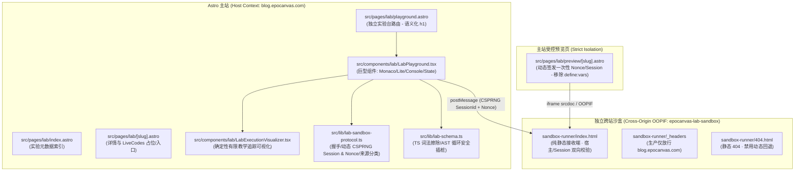

# Astro Theme Shijianus — Lab Phase 2.8 交接与基线报告 (Handoff & Readiness Baseline)

> 本文档由独立架构与安全治理审计生成，作为 Phase 2.7 结束及启动 Phase 2.8 架构重构、供应链升级与就绪验证的唯一基线交接凭证。

---

## 1. 当前 Git 状态与引用基线 (Exact Git State)

- **当前审查分支**：[`review/lab-phase-2.7-audit`](file:///home/shijian/projects/shijianus-blog)
- **基线祖先链**：`main` (`2e92967`) -> `review/lab-phase-2.5` (`4c8c0ea`) -> `review/lab-phase-2.7-audit`
- **远端当前状态**：
  - `origin/main` & `cf/main`：`2e92967072febadd70e03d13bfd1cc6e2207bc55`（严格同步，零修改）
  - `origin/review/lab-phase-2.7-audit` & `cf/review/lab-phase-2.7-audit`：`bd7216252657102ccee208ebc983551c63c4a9d5`
- **本轮本地治理与交接提交**：
  1. `37a2fa0` `chore(governance): establish tiered authorization matrix, remove default push-all and prod deploy`
  2. `2d622ca` `docs(lab-audit): correct post-audit remote push status and re-affirm Phase 2.7 NO-GO decision`
  3. `4b8c78e` `docs(lab-handoff): add Phase 2.8 architecture, risk matrix, and release readiness handoff specifications`
  4. `[当前提交]` `docs(agents): log Task 124 authorized full push to origin and cf`
- **工作区状态**：干净（`nothing to commit, working tree clean`）。

---

## 2. 代码结构与架构组件全景 (Code Architecture Overview)



### 核心路径清单
- **页面路由**：
  - [`src/pages/lab/index.astro`](file:///home/shijian/projects/shijianus-blog/src/pages/lab/index.astro)
  - [`src/pages/lab/[slug].astro`](file:///home/shijian/projects/shijianus-blog/src/pages/lab/[slug].astro)
  - [`src/pages/lab/playground.astro`](file:///home/shijian/projects/shijianus-blog/src/pages/lab/playground.astro)
  - [`src/pages/lab/preview/[slug].astro`](file:///home/shijian/projects/shijianus-blog/src/pages/lab/preview/[slug].astro)
- **组件与核心逻辑**：
  - [`src/components/lab/LabPlayground.tsx`](file:///home/shijian/projects/shijianus-blog/src/components/lab/LabPlayground.tsx)
  - [`src/components/lab/LabExecutionVisualizer.tsx`](file:///home/shijian/projects/shijianus-blog/src/components/lab/LabExecutionVisualizer.tsx)
  - [`src/lib/lab-schema.ts`](file:///home/shijian/projects/shijianus-blog/src/lib/lab-schema.ts)
  - [`src/lib/lab-sandbox-protocol.ts`](file:///home/shijian/projects/shijianus-blog/src/lib/lab-sandbox-protocol.ts)
  - [`src/lib/lab-tracer.ts`](file:///home/shijian/projects/shijianus-blog/src/lib/lab-tracer.ts)
- **沙盒运行端**：
  - [`sandbox-runner/index.html`](file:///home/shijian/projects/shijianus-blog/sandbox-runner/index.html)
  - [`sandbox-runner/_headers`](file:///home/shijian/projects/shijianus-blog/sandbox-runner/_headers)
  - [`sandbox-runner/404.html`](file:///home/shijian/projects/shijianus-blog/sandbox-runner/404.html)
- **部署与测试脚本**：
  - [`scripts/deploy-lab-sandbox.mjs`](file:///home/shijian/projects/shijianus-blog/scripts/deploy-lab-sandbox.mjs)
  - [`scripts/verify-lab-platform.mjs`](file:///home/shijian/projects/shijianus-blog/scripts/verify-lab-platform.mjs)
  - [`scripts/verify-lab-cloudflare-preview.mjs`](file:///home/shijian/projects/shijianus-blog/scripts/verify-lab-cloudflare-preview.mjs)
  - [`scripts/verify-lab-release-gate.mjs`](file:///home/shijian/projects/shijianus-blog/scripts/verify-lab-release-gate.mjs)
  - [`scripts/verify-lab-phase27-security.mjs`](file:///home/shijian/projects/shijianus-blog/scripts/verify-lab-phase27-security.mjs)

---

## 3. 已完成能力清单 (Completed Capabilities)

- [x] **治理规范重构 (Governance Baseline)**：
  - 彻底移除了 `AGENTS.md` 中的默认 `git push --all`、多远端强制同步与默认生产部署；
  - 建立了 Read-only / Local-write / Remote-write / Production 四级细粒度逐项授权矩阵；
  - 纠正了 Phase 2.7 报告在 `AGENTS.md` 中的虚假 CONDITIONAL GO 描述，统一正本清源为 **`NO-GO`**。
- [x] **执行层防循环与异步洪泛守卫 (Execution Flood Guards)**：
  - 无花括号 `for-of` / `for-in` 语法插桩补全；
  - 循环头部闭包 IIFE 注入安全守卫；
  - `requestAnimationFrame` 限制最多 256 次并发请求；
  - 沙盒 `console` 序列化增加截断与大小限制，阻断 4MB `TypedArray` 卡死主线程。
- [x] **跨站通信与凭据加固 (Cross-Origin Session Hardening)**：
  - 每次执行签发动态 128-bit CSPRNG `sessionId` 与 `nonce`，杜绝静态构建期复用；
  - 彻底移除 `LabDashboard.astro` 中的 `define:vars`，封堵 CVE 注入面；
  - 生产态沙盒严格限制 `frame-ancestors https://blog.epocanvas.com;`，移除通配符。
- [x] **非可信代码 Fail-Closed 策略 (Fail-Closed Untrusted Enforcement)**：
  - 畸形或损坏的 `#bundle=` 严格拒绝执行，阻断静默降级为官方代码；
  - 本地草稿篡改基线核对，封堵 `draftOriginKind: 'official'` 提权洗白；
  - `pagehide` 事件触发跨站沙盒会话清理。
- [x] **无障碍与 CI 门禁基准 (A11y & CI Baseline)**：
  - `/lab/playground/` 与 `/lab/preview/[slug]/` 补齐语义化 `<h1>`；
  - CI 工作流 `lab-ci-gate.yml` 采用 40 位 SHA 锁定与只读权限；
  - 建立 10 点发布门禁测试套件。

---

## 4. 未完成能力与 Phase 2.8 待办清单 (Pending Phase 2.8 Scope)

- [ ] **Adapter 架构解耦重构 (Architecture Decoupling)**：
  - 定义统一接口：`LabEditorAdapter` 与 `LabRuntimeAdapter`；
  - 拆分巨型组件 `LabPlayground.tsx`（当前接近 1000 行），将编辑器、状态机、控制台、网络握手彻底解耦；
  - 现有轻量编辑器提取为 `LiteEditorAdapter`；
  - 现有沙盒运行器提取为 `BrowserDomRuntime`；
  - 现有执行追踪器提取为 `CuratedTraceRuntime`。
- [ ] **清除不可预测伪随机降级 (Eliminate Math.random Fallback)**：
  - [`src/lib/lab-sandbox-protocol.ts:284`](file:///home/shijian/projects/shijianus-blog/src/lib/lab-sandbox-protocol.ts#L284) 中的 `createRandomToken` 仍保留 `Math.random()` 降级通道；
  - Phase 2.8 必须强制要求：当 `crypto.getRandomValues` 或 `crypto.randomUUID` 不可用时，**直接 Fail-Closed 拒绝运行非可信代码**，绝不降级。
- [ ] **postMessage 运行时 Schema 校验 (Runtime Payload Schema)**：
  - 当前 postMessage 依赖基础类型断言，缺乏严格的运行时 Schema 校验库；
  - 需引入轻量 Schema 校验（校验 type、sessionId、nonce、payload 字段类型及 64KB 总体积限制）。
- [ ] **开源技术决策与沙盒适配 (Open Source Evaluations)**：
  - **LiveCodes**：当前仅在 Schema 和部分组件中作为 URL 占位，需完成高级编辑器接口技术验证；
  - **QuickJS-Emscripten**：完成纯 JavaScript 算法运行的内存与执行超时硬抢占技术原型验证；
  - **执行追踪器定位**：在文档中明确固化其仅适用于预定义的“有限教学模型”，非全功能 JS 调试器。
- [ ] **供应链与类型系统补齐 (Supply Chain & Types)**：
  - 清理 `yarn.lock` 漂移，锁死唯一包管理器为 `npm`；
  - 修复 `package-lock.json` 中的 35 个安全漏洞（包括升级 `astro` 至安全的 6.x 最新版）；
  - 安装 `typescript` 与 `@astrojs/check`，彻底打通 `npx astro check` 静态类型门禁。
- [ ] **Cloudflare 独立沙盒生产部署 (需明确授权)**：
  - 创建独立的 Cloudflare Pages 生产沙盒项目 `epocanvas-lab-sandbox`，配置独立 eTLD+1 域名，消除 HTTP 404 硬阻断。

---

## 5. 已知 P0-P3 风险清单 (Risk Matrix)

| 风险等级 | 问题描述 | 影响文件 / 位置 | 影响范围 | 现状与修复建议 |
| :--- | :--- | :--- | :--- | :--- |
| **P0 (已阻断)** | 非可信代码逃逸与越权生产部署 | `AGENTS.md` | 全局治理 | **已修复**：删除自动部署规则，确立四级权限授权矩阵。 |
| **P1** | 生产跨站沙盒在 Cloudflare 不存在（HTTP 404） | 云端边缘 / Pages API | 生产环境 | **硬阻断**：缺少物理隔离沙盒。生产环境必须保持 Fail-Closed 禁止非可信代码运行。需用户授权创建项目。 |
| **P1** | 依赖锁文件存在 35 个已知漏洞 (2 Critical, 27 High) | `package-lock.json`, `package.json` | 供应链安全 | **硬阻断**：受 `astro@6.1.3` 及 `mermaid -> dompurify` 漏洞影响。Phase 2.8 需在单一 commit 中升级修复。 |
| **P1** | 安全 Token 存在 `Math.random` 降级通路 | [`src/lib/lab-sandbox-protocol.ts:284`](file:///home/shijian/projects/shijianus-blog/src/lib/lab-sandbox-protocol.ts#L284) | 凭证防伪造 | **待修复**：删除降级代码，Web Crypto 缺失时立即抛错中断。 |
| **P1** | 53 个 scratch 文件与历史分支暴露 | `scratch/`, 远端 `cf` 仓库 | 仓库历史 | **待清理**：按授权从跟踪树移除 `scratch/` 文件；清理公开远端冗余备份分支。 |
| **P2** | 孤立 gitlink 缺失 `.gitmodules` | `.deploy_git` (模式 160000) | Git 完整性 | **待修复**：运行 `git rm --cached .deploy_git` 移除无效 gitlink。 |
| **P2** | 深递归、ReDoS 与超大内存不可抢占 | 浏览器 DOM 运行时 | 客户端可用性 | **设计限制**：无法靠静态 AST 插桩解决，依赖跨站沙盒进程隔离与 iframe 强制卸载机制。 |
| **P2** | 类型检查处于 BLOCKED 状态 | `package.json` | 静态质量 | **待打通**：未安装 `@astrojs/check`，无法执行 `astro check`。 |
| **P3** | `LabPlayground.tsx` 巨型组件维护风险 | [`src/components/lab/LabPlayground.tsx`](file:///home/shijian/projects/shijianus-blog/src/components/lab/LabPlayground.tsx) | 架构可维护性 | **重构待办**：通过 Adapter 模式拆分逻辑与渲染层。 |

---

## 6. 需要重新执行的测试矩阵 (Required Verification Matrix)

进入 Phase 2.8 开发与验证时，必须按顺序执行以下测试并记录退出码与日志：

1. **依赖基准与审计**：
   ```bash
   npm ci
   npm audit --audit-level=high
   ```
2. **静态类型与构建检查**：
   ```bash
   npx astro check
   npm run build
   ```
3. **品牌与发布门禁套件**：
   ```bash
   npm run test:brand
   npm run test:lab:gate
   node scripts/verify-lab-phase27-security.mjs
   ```
4. **本地三核实机浏览器测试**：
   ```bash
   npm run test:lab:browsers
   ```
5. **安全与协议专项测试**：
   - 畸形/超长 `#bundle=` Fail-Closed 验证；
   - Web Crypto 禁用状态下拒绝运行非可信代码；
   - 跨站 postMessage 伪造来源（Origin Spoofing）与伪造 Session 拦截测试；
   - 64KB 以上超大 Payload 拒绝接收测试；
   - 死循环与 256 次 rAF 限制拦截验证。

---

## 7. 推荐的新对话提示词 (Recommended Next Conversation Prompt)

```text
# Astro Theme Shijianus — Lab Phase 2.8: 架构重构、供应链升级与就绪验证

你现在担任本项目的首席 Astro/React 架构师、Web Sandbox 安全工程师与供应链治理工程师。

参考基线文档：
- PHASE_2_8_HANDOFF.md
- docs/lab/LAB_PHASE_2_7_AUDIT_REPORT.md
- AGENTS.md

最高安全准则：
- 严格遵循四级权限准则（Read-only / Local-write 默认允许；Remote-write / Production 严格禁止）；
- 禁止执行 git push --all，禁止向任何远端执行未获明确单项授权的 push；
- 禁止合并 main，禁止执行生产部署，禁止修改 Cloudflare 资源；
- 保持非可信代码 Fail-Closed 铁律；
- 单步 commit 并打印 Commit Hash。

本轮目标：
1. 检出/创建本地独立分支 review/lab-phase-2.8-readiness（基于当前 HEAD）；
2. 修复供应链与锁文件：清理 yarn.lock，更新 package.json / package-lock.json 消除 Critical/High 漏洞，安装 typescript 与 @astrojs/check；
3. 执行 npx astro check、npm run build 与安全发布门禁；
4. 架构重构：基于 Adapter 模式拆分 LabPlayground.tsx（LiteEditorAdapter, BrowserDomRuntime, CuratedTraceRuntime）；
5. 彻底删除 lab-sandbox-protocol.ts 中的 Math.random 回退，确立 Web Crypto 缺失时的 Fail-Closed 机制；
6. 引入 postMessage 运行时轻量 Schema 校验（64KB 限制）；
7. 运行本地 Chromium + Firefox + WebKit 三核自动化测试套件并出示证据；
8. 输出 PHASE_2_8_READINESS_REPORT.md 并给出最终裁决。

请从核验当前 HEAD 与工作区状态开始。
```
