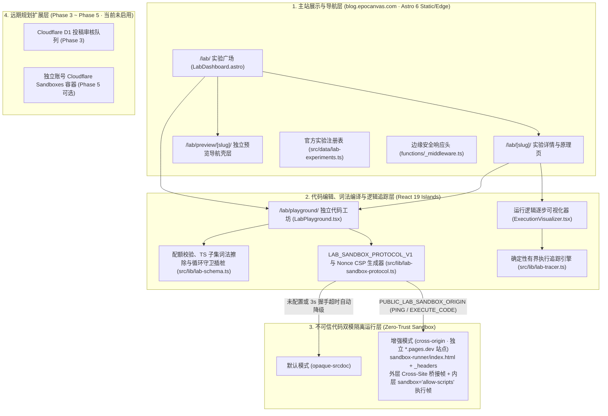

# Astro Blog「试验田 Lab」系统架构与技术选型文档 (LAB_ARCHITECTURE.md)

## 1. 目标架构概述

「试验田 Lab」是在现有 `astro-theme-shijianus`（Astro 6 + React 19 + Tailwind CSS 4 + Cloudflare Pages / D1）基础上构建的**安全隔离、零重型运行时依赖、支持确定性逻辑追踪与双模跨站沙盒的交互代码实验平台**。

核心架构划分为四个严格解耦的层次：

---

## 2. 开源技术评估与许可证合规矩阵

| 候选项目 | GitHub 仓库 | 实际许可证 | 评估结论与采用角色 |
| :--- | :--- | :--- | :--- |
| **LiveCodes** | `live-codes/livecodes` | **MIT** | **可选自托管高级 IDE 外链入口**。不在 `/lab/` 默认加载重型构建包；仅当显式配置合法的 `PUBLIC_LAB_LIVECODES_APP_URL` 时展示外跳入口。 |
| **Playground Sandbox** | `live-codes/playground-sandbox` | **MIT** | **双层沙盒模型参考**。参考其外层跨站桥接 + 内层 Opaque `srcdoc` 思路，在 `src/lib/lab-sandbox-protocol.ts` 与 `sandbox-runner/` 中自主实现 `PING -> SANDBOX_BRIDGE_READY -> EXECUTE_CODE` 握手、一次性 `nonce` CSP 与 `3000ms` 自动降级。 |
| **Sandpack** | `codesandbox/sandpack` | **Apache-2.0** (Core) / **Nodebox EULA** | **暂不引入**。多文件打包器依赖外部集群且 Nodebox 受专有 EULA 约束，不在 Phase 2.5 安装。 |
| **Codi.link** | `midudev/codi.link` | **CC BY-NC-ND 4.0** | **严格禁止复用**。协议禁止商业使用与演绎分发；本项目工坊与沙盒 100% 自主实现，零复用其代码。 |
| **JS-Interpreter** | `NeilFraser/JS-Interpreter` | **Apache-2.0** | **思想参考（暂未引入）**。Phase 2 采用零依赖确定性状态机 `src/lib/lab-tracer.ts` 覆盖核心算法追踪，不提供任意 JS 通用单步调试。 |
| **Algorithm Visualizer** | `algorithm-visualizer/algorithm-visualizer` | **MIT** | **架构参考**。采用「追踪快照生成 (`generateExecutionTrace`)」与「时间轴渲染 (`ExecutionVisualizer`)」解耦架构。 |
| **Cloudflare Sandboxes** | `@cloudflare/sandbox` | **Apache-2.0 / 商业计费** | **Phase 5 远期可选方案**。当前博客不开启服务端任意代码执行。 |

---

## 3. 核心模块与实际数据流 (`LAB_SANDBOX_PROTOCOL_V1`)

### 3.1 配额校验、TypeScript 子集词法转换与循环守卫 (`src/lib/lab-schema.ts`)
所有实验文件在进入沙盒前均在浏览器纯数据层（零 `eval`）依次完成三步处理：
1. **配额与导入包校验**：
   - `validateLabFiles()` 强制单实验最多 `MAX_FILES = 6` 个文件、单文件 `<= 64 KB`、总源码 `<= 128 KB`。
   - `validateLabPortableBundle()` 对 JSON 导入与 `#bundle=` 分享载荷执行 Schema 版本（`lab-bundle-v1`）及文件结构校验。
2. **基于词法扫描器的 TypeScript 子集类型擦除 (`transpileTypeScriptDetailed()`)**：
   - 使用零依赖词法分词器 `tokenizeTsOrJs()` 精确识别字符串、模板字符串（含嵌套 `${...}` 表达式递归处理）、正则表达式、单行/多行注释与代码 Token，**绝不对字符串、注释或对象字面量 `{ length: NODE_COUNT }` / 三元运算符 `a ? b : c` 进行盲目正则替换**。
   - **明确支持的 TypeScript 语法子集**：`interface` 声明、`type` 类型别名、变量/参数/返回值 `: Type` 注解、可选属性/参数 `?`、函数 `this: T` 伪参数、嵌套泛型调用（如 `new Map<string, Set<number>>()`）、`as Type` 与 `satisfies Type` 断言、后缀非空断言 `!`（如 `canvas.getContext('2d')!`）、`class` 字段类型与 `public`/`private`/`protected`/`readonly`/`override` 修饰符、`import type` 擦除以及同文件局部 `export` 关键字擦除。
   - **明确拒绝并给出中文诊断错误的语法**（防止静默生成语义错误代码）：`enum` / `const enum`、`namespace` / `module`、构造函数参数属性 `constructor(public x: number)`、`@decorator` 装饰器、JSX/TSX 标签语法、外部模块 `import ... from '...'` 以及未闭合的字符串或块注释。
3. **同步死循环守卫插桩 (`instrumentJavaScriptLoops()`)**：
   - 在 Token 流层面对 `while (...)`、`do { ... } while (...)`、`for (...; ...; ...)` 及 `for (... of/in ...)` 自动注入 `__labLoopGuard();` 调用，单次宏任务同步执行超过 `2200ms` 即触发不可被用户 `try/catch` 吞没的熔断异常。

### 3.2 双模沙盒运行与自动降级机制 (`src/lib/lab-sandbox-protocol.ts` & `LabPlayground.tsx`)
1. **Origin 合法性前置校验 (`resolveSafeExternalSandboxOrigin()`)**：
   - 仅接受显式 `https://` Origin（本地回环开发允许 `http://localhost:<port>` / `http://127.0.0.1:<port>`）；
   - **硬性拒绝**通配符 `*`、路径/查询串/凭据、与主站同源的 Origin，以及同站点或受主站 CORS 信任的域名（`epocanvas.com`、`*.epocanvas.com`、`*.shijianus-blog.pages.dev`、`shijianus.github.io`）。
2. **模式一：增强型跨站点桥接模式 (`cross-origin`)**：
   - 当 `PUBLIC_LAB_SANDBOX_ORIGIN` 通过校验时，主站挂载 `<iframe sandbox="allow-scripts allow-same-origin" referrerpolicy="no-referrer" src="https://<sandbox-project>.pages.dev/">`。
   - 宿主发送 `PING` 并启动 `3000ms` 握手计时器；独立站点 `sandbox-runner/index.html` 校验 `ALLOWED_HOSTS` 后回复 `SANDBOX_BRIDGE_READY`，宿主随即通过 `EXECUTE_CODE` 下发已编译的 `srcDoc` 至桥接页内部的 `<iframe id="inner-runner" sandbox="allow-scripts" referrerpolicy="no-referrer">`。
   - 若远端沙盒站点不可达、CSP 阻断或握手超过 `3000ms`，宿主自动切换至本地 `opaque-srcdoc` 模式并无缝重跑当前代码。
3. **模式二：默认本地不透明源模式 (`opaque-srcdoc`)**：
   - 直接挂载 `<iframe sandbox="allow-scripts" referrerpolicy="no-referrer" srcdoc="...">`，浏览器内核强制赋予全局唯一的 Opaque Origin（`window.origin === "null"`）。
4. **生命周期、主题与国际化联动**：
   - 路由状态：`/lab/playground/` 切换预设实验时同步执行 `history.pushState` 并监听 `popstate`，支持前进/后退与 F5 刷新保持实验上下文。
   - 主题同步：监听 `document.documentElement` 的 `data-theme` 变更，向运行中沙盒发送 `SET_THEME` 消息动态切换深浅色，无需重置画布状态。
   - 繁简切换：监听 `shijianus:localechange` 更新 React 界面按钮文案，而所有代码编辑框、源码行与 Console 输出均带有 `data-no-translate="true"` 与 `ignore-opencc`，确保源码零篡改。

### 3.3 确定性算法逐步追踪层 (`src/lib/lab-tracer.ts` & `ExecutionVisualizer.tsx`)
- 与 DOM 沙盒完全解耦：`generateExecutionTrace()` 基于纯 TypeScript 确定性状态机生成受 `MAX_TRACE_STEPS = 600` 约束的不可变快照序列 `TraceStep[]`（覆盖冒泡排序、二分查找、递归快速排序）。
- `ExecutionVisualizer.tsx` 以 `O(1)` 步进复杂度渲染源码高亮行、一维数组柱状图、指针徽章、条件判断结果与递归调用栈帧。
