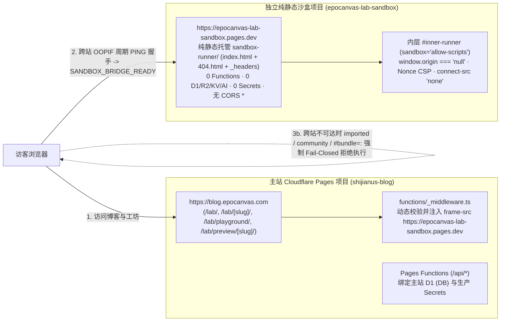

# Astro Blog「试验田 Lab」Cloudflare 部署、运维与回滚手册 (LAB_DEPLOYMENT.md)

## 1. Cloudflare 跨站点双环境部署拓扑

「试验田 Lab」采用 **主站 Cloudflare Pages 项目 (`shijianus-blog`) + 独立纯静态 Cloudflare Pages 沙盒项目** 的跨站点隔离拓扑。预发布与生产环境严格分离：

| 环境层级 | 主站入口 | 对应独立沙盒项目 | 绑定策略 |
| :--- | :--- | :--- | :--- |
| **预发布验收 (Preview / Staging)** | `https://review-lab-phase-2-5.shijianus-blog.pages.dev`<br>（及部署哈希 URL `https://6dcc30ac.shijianus-blog.pages.dev`） | `epocanvas-lab-sandbox-staging`<br>`https://epocanvas-lab-sandbox-staging.pages.dev` | 0 Functions · 0 D1/R2/KV/AI · 0 Secrets |
| **正式生产 (Production)** | `https://blog.epocanvas.com`<br>（`shijianus-blog` `main` 分支） | `epocanvas-lab-sandbox`<br>`https://epocanvas-lab-sandbox.pages.dev` | 0 Functions · 0 D1/R2/KV/AI · 0 Secrets |



### 为什么必须使用独立的 `*.pages.dev` 项目而非 `*.epocanvas.com` 子域？
1. `pages.dev` 列于 Mozilla Public Suffix List (PSL) 中，`https://epocanvas-lab-sandbox.pages.dev` 与 `https://blog.epocanvas.com` 在所有主流浏览器中属于**完全不同的可注册站点 (Cross-Site)**，不共享任何 `.epocanvas.com` 站点级 Cookie，且天然激活桌面 Chromium / Firefox 的跨站点进程隔离 (Site Isolation / OOPIF / Fission)。
2. 完全避开主站 `functions/_lib/http.ts` 对 `*.epocanvas.com` 与 `*.shijianus-blog.pages.dev` 的 CORS 凭证白名单信任范围。
3. 无需修改生产 DNS 解析记录，100% 处于 Cloudflare Pages 免费静态托管额度内（**$0 / 月**）。

---

## 2. 独立沙盒项目 (`sandbox-runner/`) 目录结构与零绑定强制红线

`sandbox-runner/` 目录仅包含 **3 个纯静态文件**（总计 `< 12 KB`）：
- `sandbox-runner/index.html`：轻量级跨站消息接收桥接器，严格校验 `event.source === window.parent` 与 `isAllowedHostOrigin(event.origin)` 后，在内部 `<iframe id="inner-runner" sandbox="allow-scripts" referrerpolicy="no-referrer">` 中挂载实验 `srcDoc`。
- `sandbox-runner/404.html`：纯静态 404 响应页，禁用 Cloudflare Pages 默认将未知路径（如 `/api/*`）`200` 回退至 `index.html` 的 SPA 兜底行为。
- `sandbox-runner/_headers`：边缘 HTTP 安全响应头（含 `! Access-Control-Allow-Origin` 剥离 Cloudflare 默认 `*` 通配头、`connect-src 'none'`、`worker-src 'none'`、`frame-ancestors` 白名单、`Referrer-Policy: no-referrer` 与 26 项 `Permissions-Policy` 封禁）。

> [!CAUTION]
> **严禁在仓库根目录直接执行裸 `npx wrangler pages deploy sandbox-runner`！**
> Phase 2.6 实测发现：在主站仓库根目录直接调用 `wrangler pages deploy sandbox-runner` 时，Wrangler 4.x 会自动扫描并编译当前工作目录下的 `./functions/`（主站 `_middleware.ts` 与 `/api/*`），将 Functions Worker bundle 一并上传至沙盒项目！
> **必须且只能**通过隔离部署脚本 [`scripts/deploy-lab-sandbox.mjs`](../../scripts/deploy-lab-sandbox.mjs) 部署沙盒。该脚本会将白名单静态文件拷贝至系统临时隔离目录 `/tmp/lab-sandbox-static-*` 并写入零绑定的最小 `wrangler.json`，且在上传日志中强制断言不存在 `Uploading Functions bundle` 或 `Compiled Worker`。

---

## 3. 主站构建期与运行期环境变量机制

| 变量名 | 配置方式 | 预发布值 / 生产推荐值 | 作用说明 |
| :--- | :--- | :--- | :--- |
| `PUBLIC_LAB_SANDBOX_ORIGIN` | 构建环境变量（`scripts/sync-lab-sandbox-env.mjs` 自动同步生成 `functions/generated/lab-env.ts`）或 Pages 纯文本环境变量 | 预发布：`https://epocanvas-lab-sandbox-staging.pages.dev`<br>生产：`https://epocanvas-lab-sandbox.pages.dev` | 1. 构建期注入 `LabPlayground.tsx` 与 `/lab/preview/[slug]/`，激活跨站桥接、官方实验超时显式回退与非官方代码强制 `Fail-Closed`；<br>2. 构建钩子写入 `BUILD_TIME_LAB_SANDBOX_ORIGIN`，由 `functions/_middleware.ts` 的 `resolveValidatedLabSandboxOrigin()` 二次校验通过后动态追加至主站 HTTP `Content-Security-Policy` 的 `frame-src` 白名单（无需触碰生产 Secrets）。 |
| `PUBLIC_LAB_LIVECODES_APP_URL` | 可选公开环境变量 | `""`（默认留空） | 仅在自托管独立 LiveCodes 实例时填写。 |

---

## 4. 正式生产发布标准命令（需获站长再次明确授权后执行）

> [!IMPORTANT]
> 以下命令仅供正式发布获批后按序执行。在未获明确授权前，严禁合并 `main`、推送生产分支或对 `shijianus-blog` 执行 `--branch main` 部署。

### 步骤 1：（可选加固）为生产独立沙盒收紧 `frame-ancestors` 并创建部署 `epocanvas-lab-sandbox`
若希望生产沙盒仅允许正式域名 `https://blog.epocanvas.com` 嵌入（保留 `epocanvas-lab-sandbox-staging` 供 `*.shijianus-blog.pages.dev` Preview 使用），可先将 `sandbox-runner/_headers` 的 `frame-ancestors` 与 `sandbox-runner/index.html` 的 `isAllowedHostOrigin` 收紧为仅 `https://blog.epocanvas.com`，随后执行：
```bash
# 1. 创建生产独立纯静态 Cloudflare Pages 沙盒项目（仅首次执行）
npx wrangler pages project create epocanvas-lab-sandbox --production-branch main

# 2. 通过零绑定隔离脚本部署纯静态沙盒（强制校验 0 Functions / 0 绑定）
node scripts/deploy-lab-sandbox.mjs --project-name epocanvas-lab-sandbox --branch main

# 3. 核验生产沙盒边缘响应头与 API 404 状态
curl -sSI https://epocanvas-lab-sandbox.pages.dev/
curl -sSI https://epocanvas-lab-sandbox.pages.dev/api/comments
```

### 步骤 2：使用生产沙盒 Origin 构建并运行本地三核门禁测试
```bash
# 1. 切换至 main 并快进合并经审查的分支
git checkout main
git merge --ff-only review/lab-phase-2.5

# 2. 使用生产独立沙盒 Origin 执行全站静态构建
PUBLIC_LAB_SANDBOX_ORIGIN="https://epocanvas-lab-sandbox.pages.dev" npm run build
npm run test:brand

# 3. 运行 Chromium + Firefox + WebKit 三核本地验收套件
node scripts/verify-lab-platform.mjs
```

### 步骤 3：同步远端仓库并部署主站生产节点
```bash
# 1. 按站长确认的远端逐一推送 main 分支
git push origin main
git push cf main

# 2. 部署至 shijianus-blog 生产分支 main
npx wrangler pages deploy dist --project-name shijianus-blog --branch main
```

### 步骤 4：生产发布后只读冒烟核验（严禁在生产执行攻击性渗透脚本）
```bash
# 核验生产 CSP frame-src 已精确包含 https://epocanvas-lab-sandbox.pages.dev 且无通配符 *
curl -sSI https://blog.epocanvas.com/lab/playground/ | grep -i content-security-policy
```
并在浏览器访问 `https://blog.epocanvas.com/lab/` 与 `https://blog.epocanvas.com/lab/playground/?slug=verlet-rope-physics`，确认 `data-isolation-mode="cross-origin"`、`data-exec-status="completed"` 且控制台零报错。

---

## 5. 秒级回滚与应急降级命令

当前生产环境稳定基线记录：
- **主站项目**：`shijianus-blog`
- **当前生产 Deployment ID**：`15603502-14f1-4340-b4b1-4f126ee24068`
- **当前生产 Git Commit (`main` / `origin/main` / `cf/main`)**：`2e92967072febadd70e03d13bfd1cc6e2207bc55` (`2e92967`)

### 方案 A：Cloudflare Pages 生产整包秒级回滚（推荐 · 约 10 秒生效）
```bash
# 一键将 shijianus-blog 生产流量切回发布前基线部署 15603502-14f1-4340-b4b1-4f126ee24068 (2e92967)
npx wrangler pages deployment rollback 15603502-14f1-4340-b4b1-4f126ee24068 --project-name shijianus-blog
```
（亦可登录 Cloudflare Dashboard -> `Workers & Pages` -> `shijianus-blog` -> `Deployments` -> 选择 `15603502-14f1-4340-b4b1-4f126ee24068` 点击 `Rollback to this deployment`。）

### 方案 B：仅关闭跨站沙盒桥接、保留官方实验单站模式（约 1 分钟）
若独立沙盒域名维护但仍需保留 Lab 官方实验展示：
1. **自动降级（0 人工介入）**：`official` 官方实验在 `4500ms` 握手超时后会自动展示提示横幅并回退至本地 `opaque-srcdoc`；`imported` / `community` / `#bundle=` 非官方代码自动 `Fail-Closed` 阻断执行。
2. **手动关闭跨站配置重发**：
   ```bash
   PUBLIC_LAB_SANDBOX_ORIGIN="" npm run build
   npx wrangler pages deploy dist --project-name shijianus-blog --branch main
   ```

### 方案 C：Git 源码级回退
```bash
git checkout main
git reset --hard 2e92967072febadd70e03d13bfd1cc6e2207bc55
# 经确认后推送并重新构建部署基线版本
```

---

## 6. 成本与平台配额说明

- **Cloudflare Pages 静态托管**：`epocanvas-lab-sandbox-staging` 与 `epocanvas-lab-sandbox` 仅包含 3 个纯静态文件（`< 12 KB`），静态资产请求在 Cloudflare Pages Free / Pro 计划下均为**不限请求次数（$0 增量月费）**。
- **Functions / D1 消耗**：独立沙盒项目为 **0 Functions、0 D1**；主站仅复用既有 `_middleware.ts` 注入响应头，对 Workers Functions 与 D1 行读写配额的新增消耗为 **0**。
