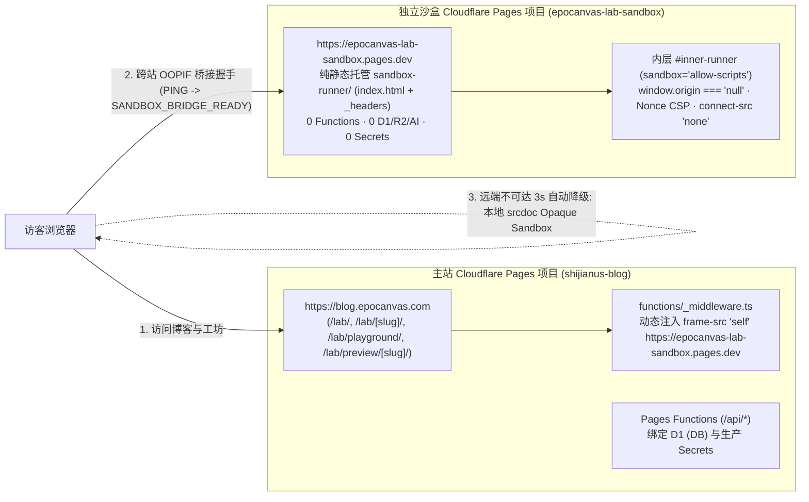

# Astro Blog「试验田 Lab」Cloudflare 部署、运维与回滚手册 (LAB_DEPLOYMENT.md)

## 1. 推荐的 Cloudflare 双站点部署拓扑

「试验田 Lab」支持**零外部依赖开箱即用（本地 `opaque-srcdoc` 模式）**与**跨站点进程隔离增强部署（独立 `*.pages.dev` 静态项目模式）**，推荐生产采用跨站点双 Pages 项目拓扑：



### 为什么优先使用独立的 `*.pages.dev` 项目而非 `*.epocanvas.com` 子域？
1. `pages.dev` 列于 Mozilla Public Suffix List (PSL) 中，`https://epocanvas-lab-sandbox.pages.dev` 与 `https://blog.epocanvas.com` 在所有主流浏览器中属于**完全不同的可注册站点 (Cross-Site)**，不会共享任何 `.epocanvas.com` 站点级 Cookie，且天然激活桌面 Chromium / Firefox 的跨站点进程隔离 (Site Isolation / OOPIF)。
2. 避开主站 `functions/_lib/http.ts` 对 `*.epocanvas.com` 与 `*.shijianus-blog.pages.dev` 的 CORS 信任范围。
3. 无需购买新域名或修改生产 DNS 解析记录，100% 处于 Cloudflare Pages 免费静态托管额度内（**$0 / 月**）。

---

## 2. 独立沙盒项目 (`sandbox-runner/`) 配置规范

`sandbox-runner/` 目录仅包含两个纯静态文件：
- `sandbox-runner/index.html`：轻量级跨站消息接收桥接器，校验 `event.origin` 属于 `ALLOWED_HOSTS`（HTTPS 下仅允许 `https://blog.epocanvas.com`）后，在内部 `<iframe id="inner-runner" sandbox="allow-scripts" referrerpolicy="no-referrer">` 中挂载实验 `srcDoc` 并回传受限消息。
- `sandbox-runner/_headers`：由 Cloudflare Pages 边缘直接下发的 HTTP 安全响应头：
  - `Content-Security-Policy: default-src 'none'; script-src 'unsafe-inline' 'unsafe-eval'; style-src 'unsafe-inline'; img-src data: blob:; media-src data: blob:; font-src data:; connect-src 'none'; worker-src 'none'; frame-src 'self' blob:; child-src 'self' blob:; object-src 'none'; base-uri 'none'; form-action 'none'; frame-ancestors https://blog.epocanvas.com http://localhost:4321 http://127.0.0.1:4321 http://127.0.0.1:4355 http://127.0.0.1:4357;`
  - `X-Content-Type-Options: nosniff`
  - `Referrer-Policy: no-referrer`
  - `Permissions-Policy: camera=(), microphone=(), geolocation=(), payment=(), usb=(), serial=(), hid=()`
  - `Cross-Origin-Opener-Policy: same-origin`
  - `Cross-Origin-Resource-Policy: cross-origin`

### 独立沙盒项目强制安全红线
- **零 Functions**：`sandbox-runner/` 下严禁放置 `functions/` 目录或 `_worker.js`。
- **零资源绑定**：严禁绑定主站 D1 (`DB`)、R2、KV、Workers AI。
- **零敏感环境变量**：严禁配置 `ADMIN_TOKEN`、`STRIPE_SECRET_KEY`、`TELEGRAM_BOT_TOKEN`、`EPOMAIL_*` 等任何密钥。

---

## 3. 主站环境变量与 CSP 联动配置

| 变量名 | 配置位置 | 推荐生产值 | 作用说明 |
| :--- | :--- | :--- | :--- |
| `PUBLIC_LAB_SANDBOX_ORIGIN` | 主站构建环境 & Cloudflare Pages Production/Preview Environment Variables | `https://epocanvas-lab-sandbox.pages.dev`（或留空 `""` 使用默认本地 `opaque-srcdoc`） | 1. 构建期注入 `LabPlayground.tsx` 与 `/lab/preview/[slug]/`，激活跨站桥接与 3s 超时自动降级；<br>2. 运行期由 `functions/_middleware.ts` 的 `resolveValidatedLabSandboxOrigin()` 校验通过后动态追加至主站 HTTP `Content-Security-Policy` 的 `frame-src` 白名单。 |
| `PUBLIC_LAB_LIVECODES_APP_URL` | 可选公开环境变量 | `""`（默认留空） | 仅在自托管独立 LiveCodes 实例时填写。 |

---

## 4. 预发布验收与正式发布标准操作顺序（需获授权后执行）

> **重要提醒**：创建 Cloudflare Pages 项目、推送远端 Git 仓库与部署生产节点均需站长明确授权后方可操作。

### 步骤 1：创建并部署独立静态沙盒 Pages 项目
```bash
# 1. 创建纯静态 Cloudflare Pages 项目（仅首次执行）
npx wrangler pages project create epocanvas-lab-sandbox --production-branch main

# 2. 部署 sandbox-runner 纯静态目录
npx wrangler pages deploy sandbox-runner --project-name epocanvas-lab-sandbox --branch main
```
验证沙盒响应头：
```bash
curl -sI https://epocanvas-lab-sandbox.pages.dev/ | grep -iE 'content-security-policy|referrer-policy|permissions-policy'
```
确认返回 `200`，且包含 `connect-src 'none'` 与 `frame-ancestors https://blog.epocanvas.com`。

### 步骤 2：在主站 Preview 环境联调预发布验收
1. 在 Cloudflare Dashboard -> `Workers & Pages` -> `shijianus-blog` -> `Settings` -> `Environment variables` 中，先为 **Preview** 与 **Production** 环境添加纯文本变量：
   - `PUBLIC_LAB_SANDBOX_ORIGIN = https://epocanvas-lab-sandbox.pages.dev`
2. 本地带该变量执行构建并推送至 Preview 分支（或执行 Preview 部署）：
   ```bash
   PUBLIC_LAB_SANDBOX_ORIGIN=https://epocanvas-lab-sandbox.pages.dev npm run build
   npx wrangler pages deploy dist --project-name shijianus-blog --branch lab-staging-preview
   ```
   *(注：若在 `*.shijianus-blog.pages.dev` 预览域名上联调跨站嵌入，需在联调期间将预览域名临时加入 `sandbox-runner/_headers` 的 `frame-ancestors` 与 `sandbox-runner/index.html` 的 `ALLOWED_HOSTS`，验收通过后移除预览域再发正式版。)*

### 步骤 3：正式发布主站 (`blog.epocanvas.com`)
```bash
# 1. 使用生产沙盒 Origin 执行全量构建
PUBLIC_LAB_SANDBOX_ORIGIN=https://epocanvas-lab-sandbox.pages.dev npm run build

# 2. 执行本地全链路自动化回归测试
node scripts/verify-lab-platform.mjs

# 3. 提交并同步多远端后部署主站
git add .
git commit -m "feat(lab): harden Phase 2.5 cross-site sandbox, TS lexer & security guards"
git push --all origin
git push --all cf
npx wrangler pages deploy dist --project-name shijianus-blog --branch main
```

### 步骤 4：线上生产环境实机验收清单
1. 检查 `curl -sI https://blog.epocanvas.com/lab/playground/` 响应头中 `Content-Security-Policy` 的 `frame-src` 包含 `https://epocanvas-lab-sandbox.pages.dev` 且不含通配符 `*`。
2. 浏览器访问 `https://blog.epocanvas.com/lab/`、`/lab/verlet-rope-physics/`、`/lab/algorithm-execution-tracer/`、`/lab/playground/`，确认 `#lab-playground-workspace` 的 `data-isolation-mode="cross-origin"` 且 `data-exec-status="completed"`，控制台 0 报错。

---

## 5. 一分钟快速降级与回滚手册

1. **自动无感降级（0 人工介入）**：
   - 若 `epocanvas-lab-sandbox.pages.dev` 出现网络波动或边缘故障，主站 `LabPlayground` 与独立预览页会在 `3000ms` 握手超时后自动切换至本地 `opaque-srcdoc` 模式（`sandbox="allow-scripts"` + `connect-src 'none'`），访客仍可正常安全运行所有实验。
2. **仅关闭跨站桥接、退回纯单站模式（约 1 分钟）**：
   - 在 Cloudflare Dashboard 中清空 `PUBLIC_LAB_SANDBOX_ORIGIN` 并重新触发部署，无需回滚代码。
3. **主站整包秒级回滚（约 10 秒）**：
   - 进入 Cloudflare Dashboard -> `Workers & Pages` -> `shijianus-blog` -> `Deployments`，找到上一稳定版本点击 `Rollback to this deployment`，全球边缘节点即刻恢复至上线前状态。

---

## 6. 成本与平台配额说明

- **Cloudflare Pages 静态托管**：`epocanvas-lab-sandbox` 仅包含 `< 12 KB` 静态 HTML 与 `_headers`，静态资产请求在 Cloudflare Pages Free / Pro 计划下均为**不限请求次数（$0 增量月费）**。
- **构建次数配额**：Cloudflare Pages Free 计划每月提供 `500` 次构建额度；使用本地 `wrangler pages deploy` 直接上传构建产物不消耗云端构建分钟数。
- **Functions / D1 消耗**：Phase 2.5 不新增任何后端 API 或 D1 表读写，对现有 Workers Functions 配额与 D1 行读写配额的额外消耗为 **0**。
