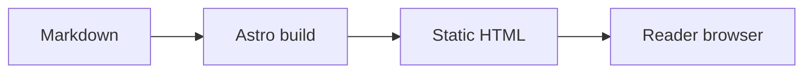

# EpoCanvas 內容格式與 Markdown 實作指南

本指南描述的是 `shijianus-blog` 目前真正使用的內容管線，而不是把所有靜態網站生成器都宣稱成本站原生支援。文章可作為寫作參考、功能範例與審核清單；若本文與 `src/content.config.ts`、`astro.config.mjs` 或實際建置結果不一致，程式碼與建置結果優先。

> [!IMPORTANT]
> 本專案的內容入口是 `src/content/posts/` 下的 `.md`/`.mdx` 檔案，採用 YAML front matter。AsciiDoc、Org-mode、reStructuredText、Textile 與 WordPress 原生格式可作為比較或遷移背景，但目前沒有被本專案的內容集合直接當成輸入格式。

> [!NOTE]
> 互動元件是「正文中的 HTML 結構 + 主題增強腳本」的組合。範例能否運作，取決於 class、data 屬性、頁面掛載的 `ContentFeatureEnhancer` 與 CSS；只複製外觀文字而不保留結構，不能保證互動正常。

## 1. 目前內容管線的責任邊界

### 1.1 輸入檔案與解析器

`src/content.config.ts` 以 Astro content loader 掃描 `src/content/posts/` 下的 `.md` 與 `.mdx` 檔案，並為每個條目產生內容 ID。`astro.config.mjs` 目前啟用：

| 層 | 目前使用的實作 | 作用 |
| :--- | :--- | :--- |
| 內容集合 | Astro content loader + Zod schema | 檢查 front matter 欄位與型別 |
| Markdown | Astro Markdown 管線 | 產生文章 HTML 與標題結構 |
| GFM | `remark-gfm` | 表格、刪除線、任務清單等 GitHub Flavored Markdown 語法 |
| 數學式 | `remark-math` + `rehype-katex` | 建置期將 `$...$`/`$$...$$` 轉成 KaTeX HTML |
| 程式碼 | Shiki | 依語言與明暗主題產生高亮程式碼 |
| MDX | `@astrojs/mdx` | 在 `.mdx` 中使用受控 JSX/元件語法 |
| 正文增強 | `ContentFeatureEnhancer.astro` | 表格包裹、告示框、Tabs、折疊、媒體、加密區塊等互動增強 |

### 1.2 靜態與動態不是同一層

文章正文通常在建置期產生 HTML；目錄、表格包裹、告示框與部分互動元件則可能在瀏覽器載入後由增強腳本初始化。這代表：

- 「HTML 已生成」不等於「每個互動元件都已完成初始化」；
- 需要瀏覽器事件、LocalStorage、API 或視口觀察的功能，不能宣稱為零 JavaScript；
- 建置成功只證明語法與產物可生成，不證明第三方嵌入、外部 API 或媒體網址一定可用。

## 2. Front matter：以 YAML 為本專案的標準入口

最小可用文章如下：

```yaml
---
title: "文章標題"
pubDate: 2026-10-18
description: "用於 SEO 與文章卡片的簡短摘要。"
author: "shijianus"
tags: ["Astro", "Markdown"]
category: "系統設計"
---
正文從這裡開始。
```

### 2.1 目前 schema 中的主要欄位

| 欄位 | 類型/預設 | 用途與注意事項 |
| :--- | :--- | :--- |
| `title` | `string`，必填 | 文章標題 |
| `pubDate` | `Date`，必填 | 發布日期；YAML 日期會交由內容 schema 解析 |
| `updatedDate` | `Date`，可選 | 最近一次內容更新日期 |
| `version` | `string`，可選 | 內容版本；版本同步腳本會使用它追蹤變更 |
| `description` / `summary` | `string`，可選 | SEO、卡片或摘要區域使用的文字 |
| `author` | `string`，預設 `shijianus` | 顯示作者；不是帳號鑑權字段 |
| `tags` | `string[]`，預設 `[]` | 標籤列表 |
| `category` / `group` / `space` | `string`，可選 | 內容分類與導航分組 |
| `cover` / `coverAlt` | `string`，可選 | 文章封面與替代文字 |
| `featured` | `boolean`，預設 `false` | 是否進入精選內容候選 |
| `sticky` | `number`，預設 `0` | 置頂排序權重；數值意義由列表實作決定 |
| `draft` | `boolean`，預設 `false` | 草稿標記；生產內容篩選會依此處理 |
| `postFormat` | enum，預設 `standard` | `standard`、`aside`、`status`、`quote`、`gallery`、`video`、`audio`、`link`、`chat`、`image` |
| `markup` | `string`，可選 | 用來描述內容使用的標記方式 |
| `toc` / `hideToc` | boolean，可選 | 目錄生成與顯示控制 |
| `math` / `mermaid` / `mindmap` | boolean，可選 | 文章功能旗標；實際渲染仍需正文語法與增強器支持 |
| `series` | `string`，可選 | 將文章加入系列 |
| `access` | object，可選 | 密碼、雜湊、地區/IP 允許或封鎖設定 |
| `externalEncrypt` / `externalEncrypts` | object/array，可選 | 受保護版本的雜湊與路由設定；不能把明文密碼寫入公開正文 |
| `i18nKey` / `lang` | `string`，可選 | 關聯翻譯與語言；本篇先以正體中文維護 |

欄位名稱是資料契約的一部分。新增欄位前應先更新 schema、使用它的元件與測試，不要只在 front matter 中自行發明字段。

### 2.2 日期與版本同步

本專案的 `scripts/sync-content-versions.mjs` 會依內容雜湊同步 `version` 與 `updatedDate`。人工改寫文章後，請檢查：

1. 版本是否需要提升 `PATCH`、`MINOR` 或 `MAJOR`；
2. `updatedDate` 是否反映真正的內容改動；
3. 版本清單是否只包含此次必要差異；
4. 建置腳本是否因自動同步產生額外檔案修改。

## 3. Markdown 與 GFM 基礎寫法

### 3.1 標題、段落與列表

```markdown
## 小節標題

用一個空行分隔段落。行內程式碼使用 `code`。

- 無序項目
- 第二個項目

1. 有序步驟
2. 下一個步驟
```

建議從 `##` 開始撰寫正文小節，讓頁面標題 `#` 保持唯一；不要用連續空格或 HTML 換行堆出版面，響應式排版應交給 CSS。

### 3.2 引用與 GitHub Alert

普通引用：

```markdown
> 先說明前提，再給出結論。
```

需要語義告示時使用 GitHub Alert 形式：

```markdown
> [!WARNING]
> 這項操作會改變資料，請先確認備份與回滾方式。
```

目前正文增強器會把常見告示引用轉為主題樣式；請使用 `NOTE`、`TIP`、`IMPORTANT`、`WARNING`、`CAUTION` 等清楚的類型，不要只依顏色傳達危險程度。

### 3.3 表格與任務清單

```markdown
| 欄位 | 說明 |
| :--- | :--- |
| `title` | 文章標題 |
| `pubDate` | 發布日期 |

- [x] 完成 schema 檢查
- [ ] 執行建置與瀏覽器驗證
```

增強器會為正文表格建立可滾動包裹，避免寬表格破壞行動裝置版面。任務清單預設是內容狀態；若需要可保存勾選狀態的教學清單，才使用主題提供的 `.article-task-tracker` 結構，並清楚標示其 `data-storage-key`。

## 4. 程式碼、HTML 與 MDX

### 4.1 程式碼區塊

```typescript
type ArticleMeta = {
  title: string;
  pubDate: Date;
};

export function isPublished(meta: ArticleMeta, now = new Date()) {
  return meta.pubDate.getTime() <= now.getTime();
}
```

請標示正確語言，例如 `typescript`、`astro`、`bash`、`json` 或 `sql`。若程式碼包含不應執行的 HTML，使用 fenced code block；不要直接把範例中的 `<script>` 寫成正文 HTML。

### 4.2 原生 HTML

Markdown 正文可以混用受控 HTML，常見於圖片、媒體與主題元件：

```html
<div class="article-aside">
  <p>這是一個語義清楚的提示區塊。</p>
</div>
```

HTML 不是繞過內容安全與無障礙要求的通行證。所有圖片都應有 `alt`，按鈕應使用 `button`，外部連結應標示必要的 `rel`，自訂元件應避免依賴固定像素才能閱讀。

### 4.3 MDX 的適用範圍

`.mdx` 可在 Astro 的 MDX 整合下使用 JSX/元件，但元件必須能在建置環境解析，且要考慮是否需要 client directive。把 React 或 Astro 元件直接貼進 `.md` 不會自動變成可用的 MDX；反過來，將需要瀏覽器 API 的元件改成純 Markdown 也不會保留互動。

## 5. 數學式、圖表與心智圖

### 5.1 KaTeX 數學式

行內公式使用單一美元符號：$E = mc^2$。

區塊公式使用雙美元符號：

$$
\text{ReadingRate} = \frac{\text{completed sections}}{\text{active minutes}}
$$

本專案透過 `remark-math` 與 `rehype-katex` 在建置期處理公式；文章 front matter 應設定 `math: true` 以表達該文章確實使用數學功能。公式中的 HTML、未跳脫底線與不完整分隔符可能使建置失敗，提交前應執行建置。

### 5.2 Mermaid

使用 `mermaid` fenced block：



文章 front matter 使用 `mermaid: true`。Mermaid 是否在瀏覽器完成圖形初始化，仍取決於頁面增強器、圖表語法與瀏覽器執行環境；不要把 Mermaid 圖表寫成支付、鑑權或資料持久性的證據。

### 5.3 Mindmap/Markmap

本主題為 `mindmap`/`markmap` 程式碼區塊提供語言識別與互動增強入口：

````markdown
```mindmap
# 內容管線
## Front matter
### YAML
## 正文
### Markdown
```
````

心智圖是閱讀輔助，不應取代正文中的順序說明、資料表或無障礙文字。層級過深時請補充普通標題與列表，避免只有圖形而沒有可讀文本。

## 6. 主題互動元件

### 6.1 Tabs 與下拉切換器

`ContentFeatureEnhancer.astro` 目前會尋找 `.article-tabs`、`.article-tabs__button`、`.article-tabs__panel`，以及 `.article-dropdown-switcher`、`.article-dropdown-panel` 等結構。最小 Tabs 範例：

```html
<div class="article-tabs">
  <div class="article-tabs__nav">
    <button class="article-tabs__button is-active" type="button">npm</button>
    <button class="article-tabs__button" type="button">pnpm</button>
  </div>
  <div class="article-tabs__panels">
    <div class="article-tabs__panel is-active">
      <code>npm install</code>
    </div>
    <div class="article-tabs__panel">
      <code>pnpm install</code>
    </div>
  </div>
</div>
```

按鈕與面板順序必須一一對應；初始 `is-active` 應只放在一組上。若內容包含互動表單、長程式碼或讀屏需要，請確認切換後仍可鍵盤操作。

### 6.2 折疊、告示與手風琴

普通 HTML `details`：

```html
<details>
  <summary>查看實作細節</summary>
  <p>這段內容預設收起，但仍應能以鍵盤展開。</p>
</details>
```

主題也會把特定告示引用轉成可折疊內容；需要互斥展開時，可使用 `.article-accordion-group[data-single="true"]`，但要避免把重要警告全部藏在折疊內。

### 6.3 互動清單與本機狀態

`.article-task-tracker` 支援勾選、進度計算與狀態卡片。它是瀏覽器端互動，不是伺服器任務系統；清除 LocalStorage、切換瀏覽器或使用私密模式可能重置狀態。不要把其中的「已完成」當作 CI、部署或資料庫真正成功的證明。

## 7. 圖片、畫廊、音訊與影片

### 7.1 圖片與畫廊

普通圖片：

```markdown

```

畫廊可使用主題既有的 `.article-gallery`、`.gallery-grid` 與 `.gallery-item` 結構。圖片燈箱由正文增強器初始化；若圖片沒有有效 `src` 或 `alt`，視覺效果即使看似正常，也不符合內容品質要求。

### 7.2 音訊與影片

主題支援 `.article-audio-card` 與 `.video-embed-card` 等展示結構，並會對頁面上的 `audio`/`video` 做播放互斥、行動裝置播放與基本控制屬性處理。這些處理不會消除瀏覽器下載能力，也不會替作者取得第三方音樂或影片的版權。

發布前應確認：

- 媒體來源有合法授權或明確的使用條款；
- 音訊/影片有文字標題與必要的替代說明；
- 外部 iframe 的來源、權限與隱私影響已說明；
- 不用「已禁用下載」等文字宣稱可以阻止使用者保存公開傳輸的媒體。

## 8. 受保護內容與安全寫作

內容 schema 支援 `access`、`externalEncrypt` 與 `externalEncrypts`，正文增強器也支援局部加密區塊與遮罩。這些功能的正確用途是控制展示與降低意外暴露，不是把瀏覽器變成可信任的秘密保存庫。

安全規則：

1. front matter 或 HTML 中只放密碼雜湊與必要提示，不要寫入明文密碼、API token、支付密鑰或真實個資；
2. 受保護內容一旦送到瀏覽器，就必須假設具備技術能力的使用者可能檢視或保存它；
3. 外部加密路由要驗證 slug、雜湊、權限與回退行為，不能只依賴按鈕隱藏；
4. 測試用密碼、示範 token 與真實密鑰不可寫入公開文章；
5. 文章若涉及個資、支付或內部事件，應使用最小化範例並遵守[隱私與資料使用說明](/community/privacy-and-data/)。

行內模糊、劇透或遮罩是閱讀互動，不是加密。把 `<span class="blur-text">` 或劇透元件當成機密保護，會造成錯誤的安全感。

## 9. 其他 SSG 格式的正確定位

Hugo、Jekyll、Eleventy、Hexo、Pelican、VitePress、Docusaurus、WordPress 等工具有各自的解析器與模板約定。本篇可用於比較遷移，但不能把它們的能力直接套到本專案：

| 格式/平台 | 本專案目前定位 | 遷移注意事項 |
| :--- | :--- | :--- |
| CommonMark/GFM | 主要正文格式 | 優先使用本專案建置與測試過的語法 |
| MDX | 支援 `.mdx` 檔案 | 元件、import 與 client 行為需在 Astro 中驗證 |
| HTML | 可在 Markdown 中混用受控結構 | 需自行負責語義、無障礙與安全 |
| AsciiDoc/Org/RST/Textile | 參考與遷移來源 | 目前沒有對應的內容集合 loader |
| WordPress Post Formats | 概念上的內容分類 | `postFormat` 是本專案 schema enum，不是完整 WordPress API |
| TOML/JSON front matter | 其他工具常見形式 | 本專案文章 front matter 以 YAML 為標準，勿直接照抄而不建置驗證 |

## 10. 建議的文章檢查流程

### 寫作前

- [ ] 已決定文章是普通文章、官方規範、範例或草稿。
- [ ] 已選擇必要的 `postFormat`、`math`、`mermaid`、`mindmap` 與 `toc` 欄位。
- [ ] 沒有把第三方平台能力或未實作功能寫成本站承諾。

### 建置前

- [ ] front matter 符合 `src/content.config.ts` schema。
- [ ] 標題層級、表格、程式碼、圖片 alt 與連結語義完整。
- [ ] 沒有明文密碼、token、卡號、私人資料或可利用的漏洞細節。
- [ ] Mermaid、KaTeX、Tabs、折疊、媒體與受保護內容都有對應旗標或結構。

### 交付前

- [ ] 執行靜態建置並檢查產物路由。
- [ ] 在桌面與行動裝置檢查表格、程式碼、圖片、互動元件與暗色模式。
- [ ] 檢查瀏覽器控制台與網路請求；外部服務失敗時，正文仍有可理解的降級呈現。
- [ ] 內容版本、更新日期、授權與來源說明已更新。

## 結語

好的內容格式不是把功能清單堆在文章裡，而是讓讀者能理解、重現、檢查並安全地使用內容。EpoCanvas 目前以 Astro + Markdown/GFM/MDX 為核心，透過建置期處理與局部正文增強提供數學式、圖表、媒體、折疊與互動元件；未被程式碼、schema 或測試證明的能力，就應明確標為比較、實驗或待補齊，而不是宣稱已經原生支援。

最後更新：2026-10-19。
